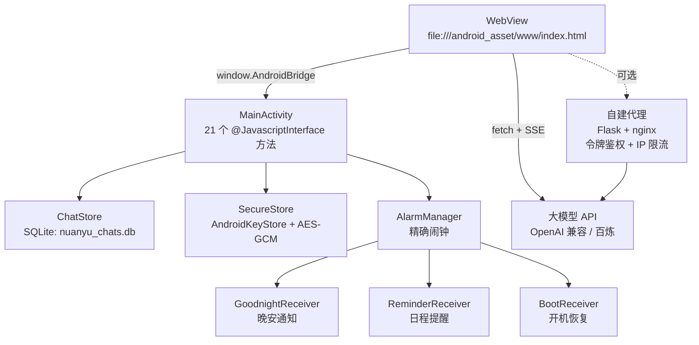

# 久伴 · 情感陪伴智能体

> 一个完全跑在手机本地的多角色情感陪伴 App。每个角色一个独立对话框，各自的人设、记忆、纪念日和聊天记录互不串台；断网也能聊，联网则接大模型。

单文件前端（HTML/CSS/原生 JS，无框架）+ Android WebView 原生壳（6 个 Java 类）+ 可选的自建代理后端（Flask）。聊天记录存 SQLite，API Key 存系统密钥库，备份文件 AES-GCM 加密。

---

## 它现在能做什么

**对话**
- 8 个内置角色：闺蜜 / 伴侣 / 死党 / 友人 / 妈妈 / 姐姐 / 学长 / 自定义
- 微信式会话列表：未读红点、按最近消息排序、长按移除
- 流式输出（逐字上屏）、消息标注 `AI生成` / `本地生成`
- 断网自动降级为离线话术，仍然记得你告诉过它的事

**记忆**
- 三层记忆：最近 12 条原文 + 长期事实（最多 60 条）+ 早期摘要（40 条触发，600 字上限）
- 模型可以自己调工具写记忆、设提醒（Function Calling，最多 3 轮）
- 一键「重新锚定」：感觉角色聊歪了，清掉压缩摘要、从原文重算

**陪伴**
- 每日晚安推送（精确闹钟，触发后自排明天，重启可恢复）
- 日程提醒（模型自己设，或手动加）
- 心情打卡、纪念日倒计时
- 语音播报（按角色开关）

**数据**
- 聊天记录存 SQLite（不再是 localStorage 的 5 MB 天花板）
- 备份文件 PBKDF2-SHA256（15 万次）+ AES-GCM-256 加密，密码错就解不开

---

## 架构



**分层**

| 层 | 承担什么 | 实现 |
|---|---|---|
| 承载 | 界面与交互 | 单文件 HTML + 原生 JS |
| 感知 | 情绪识别、时间/纪念日情境 | 关键词规则 + 日期计算 |
| 记忆 | 短期原文 / 长期事实 / 早期摘要 | 数组 + SQLite + 正则抽取 |
| 决策 | 回不回、调不调工具、走哪条通道 | 双引擎降级：模型 or 离线规则 |
| 表达 | 文字、逐字流式、语音 | SSE 解析 + TextToSpeech |
| 行动 | 主动提醒、晚安推送 | AlarmManager + BroadcastReceiver |

---

## 目录结构

```
.
├── index.html              # 单文件前端（全部业务逻辑，约 2400 行）
├── CHANGELOG.md            # 11 个版本的迭代记录
├── 技术说明-久伴.md         # 深度技术文档：关键实现 / 难点复盘 / 面试讲法
├── android/
│   ├── AndroidManifest.xml
│   ├── build.sh            # 一键构建（不依赖 Gradle）
│   ├── BUILD.md            # 手工构建七步与三个坑
│   ├── src/com/nuanyu/companion/
│   │   ├── MainActivity.java
│   │   ├── ChatStore.java
│   │   ├── SecureStore.java
│   │   ├── GoodnightReceiver.java
│   │   ├── ReminderReceiver.java
│   │   └── BootReceiver.java
│   └── res/
├── deploy/                 # 可选后端（网页版共用一把 Key 时用）
│   ├── app.py              # Flask 代理 + Bearer 鉴权 + IP 限流
│   ├── nginx-nuanyu.conf
│   ├── nuanyu.service
│   ├── deploy.sh
│   └── README-华为云部署.md
└── tests/                  # 7 套测试
    ├── test_sessions.js    # 26 项会话/角色/存储测试
    ├── test_rolepage.js    # 14 项角色主页测试
    ├── test_page.js
    ├── test_migrate.js
    ├── test_browser.js     # 无桥降级
    ├── test_conn.js        # 连接诊断
    └── test_backend.py     # 401 / 429 / 413 / CORS
```

---

## 快速开始

### 方式一：当网页用（零依赖）

直接用浏览器打开 `index.html`。功能齐全，只是没有系统通知与原生存储（自动降级为 localStorage + 浏览器提示）。

在「AI 模型」里填 OpenAI 兼容地址与 Key 即可联网对话；不填则走离线话术。

### 方式二：构建 APK

需要 JDK 8+ 与 Android SDK（build-tools + 任一 platform），不需要 Gradle。

```bash
cd android
./build.sh          # 未签名包，验证能否构建通过
# 正式包：
KS_PATH=/path/to/release.keystore KS_PASS=密码 KS_ALIAS=别名 ./build.sh
```

细节与三个必踩的坑见 [`android/BUILD.md`](android/BUILD.md)。

### 方式三：部署后端（可选）

只有在「网页版多人共用一把 Key」时才需要。后端做三件事：藏 Key、验令牌、限流。

```bash
cd deploy
bash deploy.sh      # 华为云 Ubuntu 22.04
```

详见 [`deploy/README-华为云部署.md`](deploy/README-华为云部署.md)。

> **App 版不需要后端**——每台设备填自己的 Key，直连模型厂商。

---

## 技术栈

| 位置 | 用了什么 | 为什么 |
|---|---|---|
| 前端 | 单文件 HTML + 原生 JS | 改样式不用重编译 |
| 壳 | WebView + `@JavascriptInterface` | 复用 Web 生态，按需取原生能力 |
| 存储 | SQLite（原生） | localStorage 仅 5 MB 且同源共享 |
| 密钥 | AndroidKeyStore + AES-GCM | 密钥由系统安全区托管，明文不落盘 |
| 备份 | PBKDF2-SHA256 15 万次 + AES-GCM-256 | 文件泄露也无法解密 |
| 定时 | AlarmManager `setExactAndAllowWhileIdle` | `setRepeating` 不精确，会被系统合并推迟 |
| 模型 | OpenAI 兼容接口 + SSE | 换厂商只改地址与模型名 |
| 后端 | Flask + nginx + Bearer + 限流 | 20 次/分、800 次/日 |
| 测试 | jsdom 模拟原生桥 | 不开模拟器也能测业务逻辑 |

---

## 两个关键设计

**1. 桥接 + 自动降级。** 所有原生能力都走 `window.AndroidBridge.xxx()`。启动时检测桥是否存在：有桥 → SQLite + 系统通知 + 密钥库；无桥 → localStorage + 页面提示。这一层判断是整套代码的地基，让同一份前端既能当网页跑，又能装成 App。

**2. 压缩只压缩「视图」，不压缩「数据」。** 原始消息一条不删，全部留在 SQLite。进入上下文的是「最近 12 条原文 + 提炼出的长期事实 + 早期摘要」——所以「记不住全部」是上下文窗口的限制，不是存储的限制。人设卡每轮全量注入且**不进摘要管道**，这是防止反复压缩后角色跑偏的主要手段。

---

## 隐私

- 聊天记录、记忆、纪念日只存在本机；App 没有账号体系，也不上传任何数据
- 开启大模型后，对话内容会发送给你自己配置的服务商
- API Key：App 内由 AndroidKeyStore 加密保存；网页版默认只在本次会话内保留，只有自建代理的访问令牌可选择性记住
- 备份文件加密后才落盘

---

## 测试

```bash
cd tests
node test_sessions.js && node test_rolepage.js && node test_page.js \
  && node test_migrate.js && node test_browser.js && node test_conn.js
python test_backend.py       # 需要 flask
```

用 jsdom 模拟 `AndroidBridge`，在不启模拟器的前提下覆盖会话、迁移、降级、连接诊断等路径。

---

## 版本历史

11 个可安装版本，每个版本对应一个 Git tag，前端源码可从 tag 直接检出。完整记录见 [`CHANGELOG.md`](CHANGELOG.md)。

```
v1.0  离线雏形 → v1.1 记忆与纪念日 → v1.2 智能体内核（流式/工具/摘要）
v1.3  加密备份 → v1.4 安全与配额 → v1.5 迁 SQLite → v1.6 未读与会话
v1.7  连接自检 → v1.8 令牌记忆 → v1.8.x 修复打包缺陷
v1.9  设置并入角色主页 + 防漂移锚定 → v1.9.1 修复晚安推送 → v1.10 更名久伴
```

---

## 已知限制

| 限制 | 说明 |
|---|---|
| 长期记忆是文本行 | 事实冲突靠人工纠正，尚未做结构化合并 |
| 摘要可能漂移 | 已用「人设卡不进压缩 + 一键重新锚定」缓解，未做自动漂移检测 |
| 无账号体系 | 换机靠备份文件迁移 |
| 侧载安装 | 未上架应用市场，鸿蒙需手动放开「应用启动管理」的后台限制 |

---

## License

个人项目，仅供学习交流。使用前请自行配置你自己的模型 API Key，并遵守相应服务商的条款。
